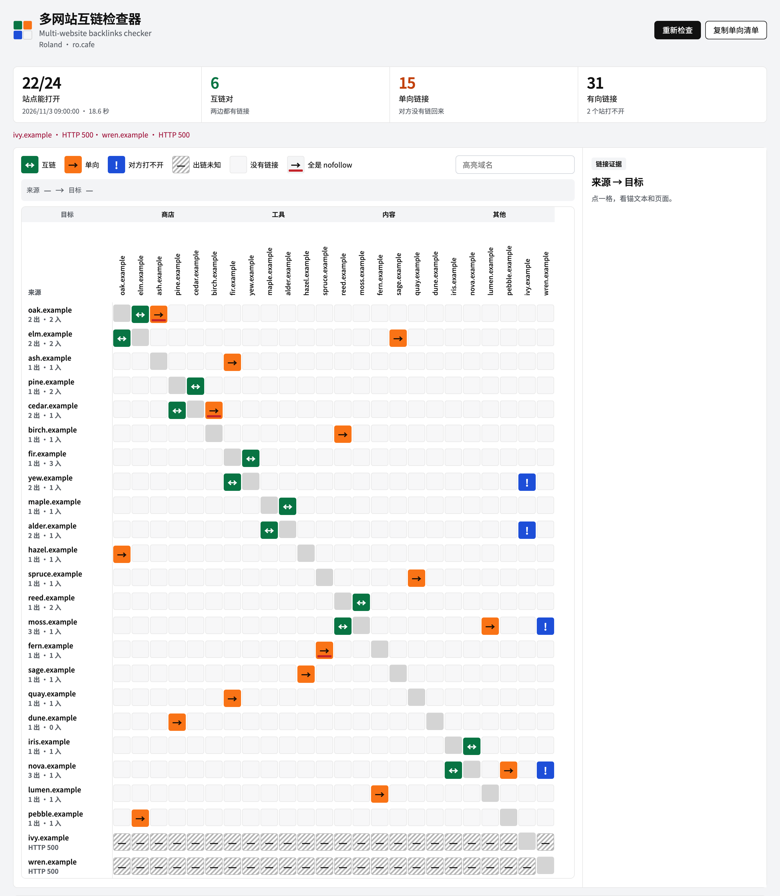
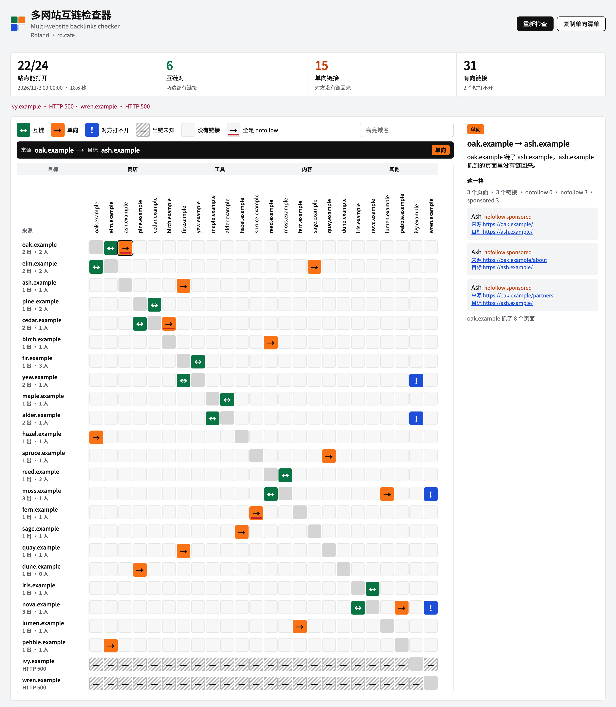

<a id="readme-top"></a>

<div align="center">
  

  <h1>多网站互链检查器</h1>

  <p>Multi-website backlinks checker</p>

  <p>一份网站名单，看谁链了谁。只统计名单内部的链接。</p>

  <p>
    <a href="https://www.python.org/"></a>
    
    <a href="https://github.com/chainepic/multi-website-backlinks-checker/stargazers"></a>
  </p>

  <p>作者 <a href="https://ro.cafe">Roland · ro.cafe</a></p>

  <p>
    <a href="#界面">界面</a>
    ·
    <a href="#开始">开始</a>
    ·
    <a href="#名单">名单</a>
    ·
    <a href="#格子">格子</a>
    ·
    <a href="#抓取范围">抓取范围</a>
  </p>
</div>

## 界面

下面两张图用的都是 `*.example` 域名，只为展示界面。

<p align="center">
  
</p>

<p align="center">点开一格之后，锚文本和页面在右侧。</p>

<p align="center">
  
</p>

<p align="right"><a href="#readme-top">回到顶部</a></p>

## 开始

需要 Python 3.10 或更新版本。没有第三方依赖。

```bash
git clone https://github.com/chainepic/multi-website-backlinks-checker.git
cd multi-website-backlinks-checker
cp sites.example.json sites.json
python3 server.py
```

打开 http://127.0.0.1:8787 。点开「名单」，粘贴网址，一行一个，点「加入名单」。删掉某个站，点它旁边的「移除」。改完点「重新检查」，矩阵才会按新名单重算。

也可以直接改 `sites.json`。

<p align="right"><a href="#readme-top">回到顶部</a></p>

## 名单

`sites.json` 按分组写域名。`host` 不带协议，不带 `www`。

```json
{
  "max_pages_per_site": 18,
  "groups": [
    {
      "id": "shop",
      "label": "商店",
      "sites": [
        { "host": "alpha.example" },
        { "host": "beta.example", "note": "可选备注" }
      ]
    }
  ]
}
```

`max_pages_per_site` 是每个站最多抓多少页。检查结果写在 `data/report.json`。

`sites.json` 和 `data/report.json` 在 `.gitignore` 里，不会进仓库。

<p align="right"><a href="#readme-top">回到顶部</a></p>

## 格子

行是来源，列是目标。

| 格子 | 含义 |
| --- | --- |
| 绿，↔ | 互链。两边都有链接 |
| 橙，→ | 单向。对方能打开，但没有链回来 |
| 蓝，! | 对方打不开。这边有链接，回链无法确认 |
| 斜线，— | 出链未知。来源站打不开 |
| 空格 | 抓到的页面里没有这条链接 |
| 底部红线 | 这条边上的链接全是 nofollow |

<p align="right"><a href="#readme-top">回到顶部</a></p>

## 抓取范围

每个站先抓首页，再抓关于、产品、友链、合作这类页面，以及网址路径里出现了其他站名的页面。

链接只认页面里的 `a` 标签。图片、样式、正文里写出来的域名不算。

不执行 JavaScript。不查名单以外的 backlink。

## 测试

```bash
python3 -m unittest
```

测试不访问网络。

## 作者

[Roland](https://ro.cafe)

<p align="right"><a href="#readme-top">回到顶部</a></p>
